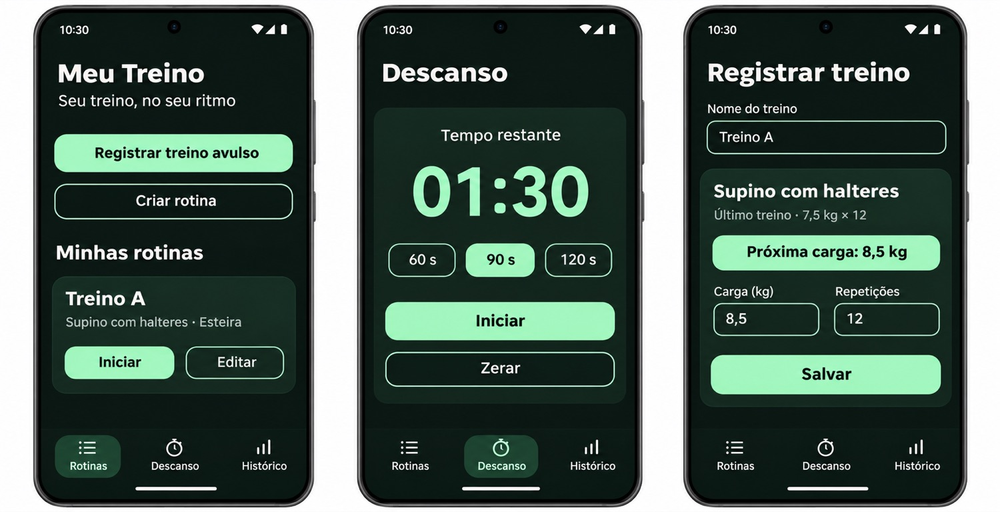

# Meu Treino

Registre musculação e cardio no Android, mesmo em modo avião. As rotinas e o histórico ficam no aparelho. O aplicativo dispensa conta.

## Baixar e instalar

O link abaixo ficará ativo quando a primeira versão for publicada no GitHub Releases.

**[Baixar Meu Treino para Android (.apk)](https://github.com/lucasdossantosxl-cyber/app-gym/releases/latest/download/meu-treino.apk)**

1. No celular, toque no link e abra o arquivo **meu-treino.apk** depois do download.
2. Se o Android pedir, abra **Configurações**, ative **Permitir desta fonte**, volte e toque em **Instalar**.
3. Abra **Meu Treino** pelo ícone na lista de apps.

## Rotinas e registros

- Em **Rotinas**, toque em **Criar rotina**. Dê um nome e adicione os exercícios na ordem desejada. Para força, escolha a unidade de carga, quantas séries quer fazer e, se quiser, uma meta de repetições e um incremento de carga.
- Toque em **Iniciar** para registrar uma sessão baseada na rotina. Use **Registrar treino avulso** para começar com uma ficha vazia. Dá para acrescentar ou remover exercícios e séries durante a sessão.
- Na musculação, informe carga e repetições. A carga aceita vírgula ou ponto. Em cardio, informe o tempo em minutos e, opcionalmente, a distância em quilômetros.
- Durante o treino, o app mostra o último registro do exercício na mesma rotina e unidade. Treinos avulsos consultam outros treinos avulsos.
- Toque em **Salvar** para gravar a sessão. Em **Histórico**, escolha **Editar registro** se precisar corrigir algo. Alterar uma rotina afeta apenas os próximos treinos iniciados a partir dela.

## Descanso entre séries

Abra a aba **Descanso** ou toque em **Cronômetro de descanso** durante o treino. Escolha **60**, **90** ou **120 segundos** e toque em **Iniciar**. Você pode pausar, retomar ou tocar em **Zerar** para voltar ao tempo escolhido. Toque em **Voltar ao treino** para continuar preenchendo a ficha enquanto o relógio segue contando. Ao terminar, a tela mostra **Descanso concluído**.

## Como a próxima carga é calculada

Configure a **meta de repetições por série** e o **incremento de carga** do exercício. Quando você completar pelo menos a quantidade planejada de séries, com a mesma carga e todas na meta ou acima, o app soma o incremento à carga utilizada.

Por exemplo, com 3 séries planejadas, meta de 12 repetições e incremento de 1 kg, fazer **12, 12 e 13 repetições com 7,5 kg** gera uma sugestão de **8,5 kg**. Com uma série abaixo da meta ou com cargas diferentes, o app mantém o último registro visível e aguarda você atingir a meta. Sem incremento, ele mostra apenas o aviso de meta atingida. Você decide se vai usar a sugestão.

## Prévia da interface

Imagem ilustrativa com dados de exemplo.



## Para quem mantém o projeto

A automação [Gerar e publicar APK Android](https://github.com/lucasdossantosxl-cyber/app-gym/actions/workflows/android-apk.yml) compila e verifica o APK. Para manter a mesma assinatura entre versões, configure o secret `ANDROID_DEBUG_KEYSTORE_BASE64` com o keystore de debug dedicado ao projeto, codificado em Base64. Preserve essa mesma chave para que futuras versões possam ser instaladas por cima da anterior. A chave deve usar o perfil padrão de debug do Android. Sem o secret, cada execução usa uma assinatura de debug nova. O Android pode recusar a instalação por cima de uma versão assinada com outra chave. A automação pode ser iniciada com **Run workflow** na branch `main`.

Para compilar localmente, use JDK 17, Android SDK Platform 35 e Gradle 8.9, com o SDK configurado no Android Studio ou via `ANDROID_HOME`.

```sh
gradle :app:assembleDebug
cp app/build/outputs/apk/debug/app-debug.apk meu-treino.apk
```

Com um aparelho ou emulador conectado, execute `gradle :app:connectedDebugAndroidTest` para verificar persistência, edição de registros e a regra de progressão.
