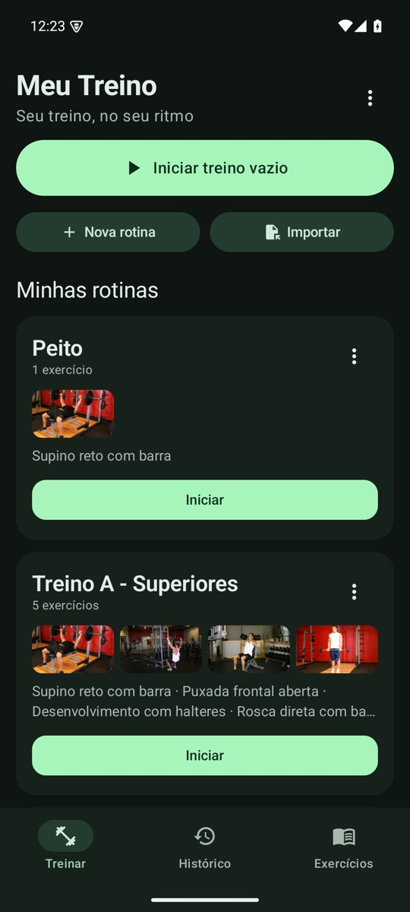
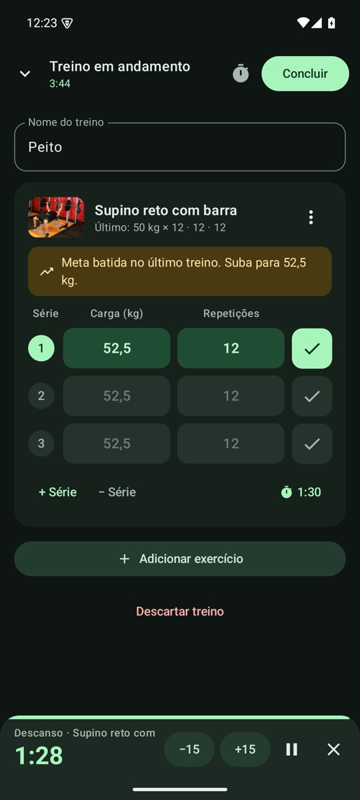
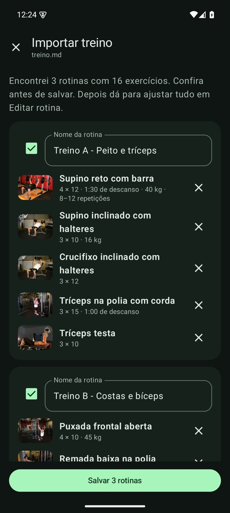
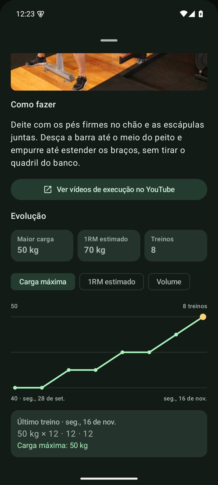
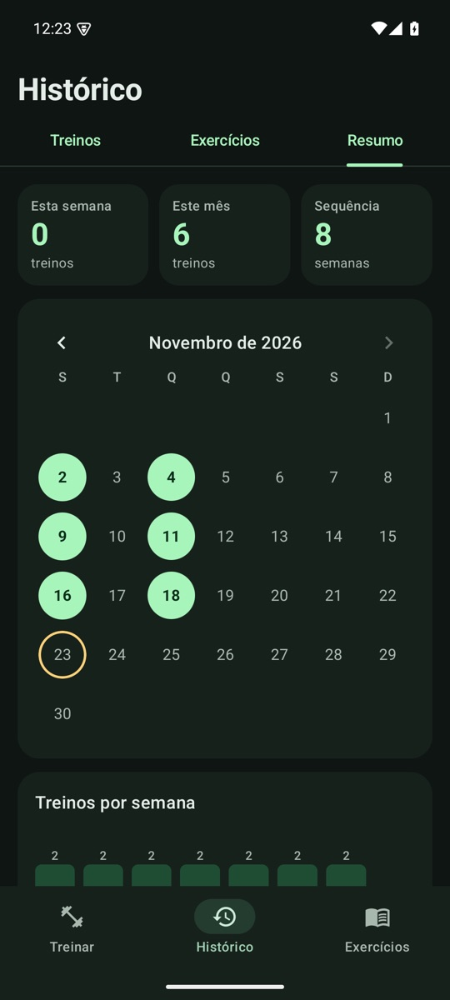
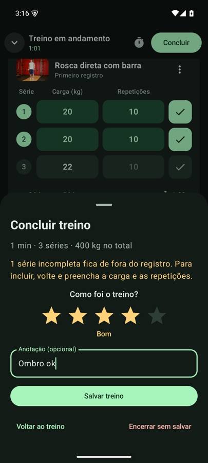
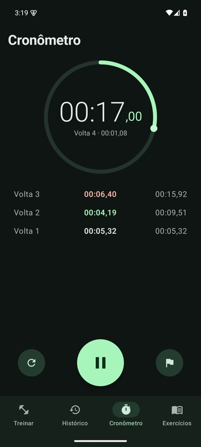
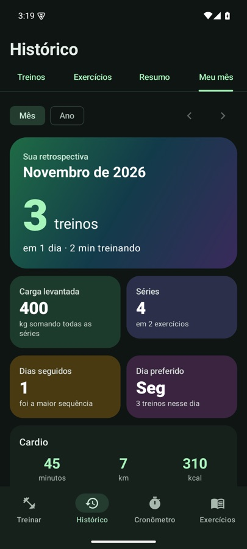

# Meu Treino

Registre musculação e cardio no Android, mesmo em modo avião. O aplicativo dispensa conta e não pede acesso à internet. As rotinas e o histórico ficam no aparelho, com cópia automática para não se perderem.

| Treinar | Treino em andamento | Importar ficha | Evolução | Resumo |
|---|---|---|---|---|
|  |  |  |  |  |

| Concluir e avaliar | Cronômetro | Meu mês |
|---|---|---|
|  |  |  |

## Baixar e instalar

**[Baixar Meu Treino para Android (.apk)](https://github.com/lucasdossantosxl-cyber/app-gym/releases/latest/download/meu-treino.apk)**

1. No celular, toque no link e abra o arquivo **meu-treino.apk** depois do download.
2. Se o Android pedir, abra **Configurações**, ative **Permitir desta fonte**, volte e toque em **Instalar**.
3. Abra **Meu Treino** pelo ícone na lista de apps.

Da versão 2.0 em diante o app é assinado com uma chave de release própria, e cada versão nova instala por cima da anterior sem apagar rotinas nem histórico. Só quem ainda tem a versão 1.x (assinada com chave de debug) precisa desinstalar o app antigo uma vez.

Para atualizar, abra **⋮ > Backup e atualização > Ver a versão mais recente** no app, baixe o APK e instale.

### Avisos do Android na instalação

Todo APK instalado fora da Play Store passa pelo Google Play Protect. O que cada aviso significa e o que este projeto faz a respeito, conforme a [orientação do Google para desenvolvedores](https://developers.google.com/android/play-protect/warning-dev-guidance) consultada em novembro de 2026:

- **"Feito para uma versão mais antiga do Android"** aparece quando o `targetSdk` do app está mais de dois níveis abaixo do Android do aparelho. A versão 1.1 mirava a API 34. A 2.0 mira a API 36.
- **"O Play Protect não conhece este app" / "Verificação recomendada"** aparece para qualquer app que o Google ainda não viu. Nenhuma mudança no código remove esse aviso. Toque em **Verificar app** e instale em seguida.
- **Registro de desenvolvedor.** O Google passou a exigir que apps sejam registrados por um desenvolvedor verificado. No Brasil a regra já vale para lojas de apps e, segundo o Google, chega às instalações diretas em 2027. Para o aviso de desenvolvedor não verificado não aparecer, registre o pacote `br.com.meutreino` e a impressão digital da chave (arquivo `signing-cert.sha256`) no [Android Developer Console](https://android.google.com/developerconsole). Há uma conta gratuita de distribuição limitada para uso pessoal.

O APK publicado não é depurável, tem o código reduzido pelo R8, usa assinatura v2 e v3 com chave estável e declara apenas as permissões de notificação, vibração e alarme exato, usadas para avisar o fim do descanso. Ele não pede acesso à internet nem ao armazenamento.

## Rotinas

- Na aba **Treinar**, toque em **Nova rotina**, dê um nome e use **Adicionar exercícios**. A biblioteca tem 280 exercícios com instruções, busca e filtro por grupo muscular, dos quais 253 com fotos próprias. Entre eles estão versões unilaterais, na polia, na máquina e no Smith, e 28 atividades de cardio. Se o exercício não estiver lá, digite o nome e toque em **Criar como força** ou **Criar como cardio**.
- Toque em um exercício da rotina para ajustar séries, meta de repetições, carga inicial, incremento, unidade (kg ou lb), descanso, observação e link de vídeo.
- **Variação.** Qualquer exercício de força aceita uma variação, como "unilateral", "pegada neutra" ou um texto seu. O nome vira "Tríceps na polia com corda · unilateral", as fotos e o passo a passo continuam os do exercício original, e a variação ganha histórico e progressão de carga separados. Durante o treino, a opção fica no menu **⋮** do exercício.
- No menu **⋮** da rotina você pode editar, duplicar ou excluir. Excluir uma rotina mantém os treinos já registrados.

## Importar uma ficha de treino

Toque em **Importar** e escolha um arquivo **.md**, **.txt** ou **.pdf**, ou cole o texto. Também funciona pelo **Compartilhar** ou **Abrir com** de outro app. O Meu Treino lê o conteúdo no próprio aparelho, mostra as rotinas encontradas para você conferir e só então salva.

O que ele entende:

```markdown
# Treino A - Peito e tríceps
- Supino reto 4x8-12 40kg descanso 90s
- Crucifixo inclinado 3x12
- Tríceps corda 3x15 descanso 60s

# Treino B - Costas e bíceps
| Exercício | Séries | Reps | Carga |
|---|---|---|---|
| Puxada frontal | 4 | 10 | 45kg |
| Rosca direta | 3 | 10 | 20kg |
- Esteira 15 min
```

- **Títulos** como `# Treino A`, `Dia 2 - Costas`, `Segunda: pernas` ou `Peito e tríceps:` começam uma rotina. Subtítulos como "Aquecimento" ficam dentro do treino.
- **Exercícios** em lista, lista numerada ou tabela: `4x10`, `3 x 8-12`, `3 séries de 12 repetições`, `3x30s`, `3x falha`. Em PDFs com colunas, `Supino reto 4 8-12 60s` também é lido.
- **Carga** (`40kg`, `20 lb`) e **descanso** (`descanso 90s`, `intervalo de 1min30`) são opcionais.
- Com uma faixa como `8-12`, a meta de repetições é o número maior.
- Nomes são comparados com a biblioteca: "Supino reto", "supino reto com barra" e "SUPINO" viram o mesmo exercício, com foto. "Tríceps corda unilateral" vira o tríceps na corda com a variação "unilateral". O que não for reconhecido entra como exercício seu, sem foto.
- PDFs precisam ter texto selecionável. Fichas escaneadas como imagem não são lidas. O limite é de 8 MB e 40 páginas.

## Durante o treino

- Toque em **Iniciar** na rotina ou em **Iniciar treino vazio**. Cada série mostra apagados os valores sugeridos: a carga e as repetições do último treino, ou a carga maior quando você bateu a meta.
- Toque em **✓** para concluir a série. Se os campos estiverem vazios, o app usa os valores sugeridos. Para registrar outro valor, digite antes de concluir.
- A seta no canto superior recolhe o treino. Uma faixa no rodapé leva de volta a ele enquanto você consulta o histórico ou a biblioteca.
- O treino em andamento é salvo a cada alteração e continua lá se o app for fechado.
- Em cardio, cada atividade tem minutos, distância, velocidade (ou nível do aparelho) e calorias. Só os minutos são obrigatórios.
- Toque em **Concluir** para ver o resumo, dar de uma a cinco estrelas ao treino e escrever uma anotação. A avaliação e a anotação aparecem no histórico.
- Dá para concluir com séries em branco ou sem nenhuma série: o que estiver vazio ou incompleto fica de fora, e o treino é salvo com a data, a duração e a avaliação.
- **Encerrar sem salvar**, na mesma tela e no fim da lista de exercícios, descarta o treino sem registrar nada.

### Descanso entre séries

Concluir uma série de força inicia o descanso. A barra no rodapé mostra o tempo restante e permite tirar ou somar 15 segundos, pausar e encerrar. Toque no tempo para escolher outra duração ou definir o padrão do app. Cada exercício pode ter o próprio descanso, no botão com o relógio abaixo das séries.

Com o app fora da tela, uma notificação mostra a contagem regressiva e outra avisa quando o descanso termina. No Android 13 ou mais novo, o app pede permissão de notificação no primeiro treino.

### Como a próxima carga é calculada

Configure a **meta de repetições** e o **incremento** do exercício. Quando você completa todas as séries planejadas com a mesma carga e todas na meta ou acima, o treino seguinte abre com um aviso e a carga somada ao incremento já sugerida.

Por exemplo, com 3 séries planejadas, meta de 12 repetições e incremento de 2,5 kg, fazer **12, 12 e 12 repetições com 50 kg** gera a sugestão de **52,5 kg**. Com uma série abaixo da meta ou com cargas diferentes, o app sugere repetir a carga anterior. O último registro vem de qualquer treino com o mesmo exercício e a mesma unidade, não só da mesma rotina.

## Cronômetro

A aba **Cronômetro** funciona como o do relógio do celular: iniciar e pausar no botão central, **zerar** à esquerda e **marcar volta** à direita. A lista mostra o tempo de cada volta e o total, com a volta mais rápida em verde e a mais lenta em vermelho. Ele continua contando com a tela apagada, em outra aba ou com o app fechado.

## Histórico

- **Treinos** lista os registros por mês, com duração, séries, carga total, estrelas e anotação. Toque em um treino para ver todas as séries, editar ou excluir.
- **Exercícios** mostra cada exercício já treinado. Toque para ver maior carga, 1RM estimado (fórmula de Epley), volume e o gráfico de evolução. Toque em um ponto do gráfico para ver aquele treino.
- **Resumo** traz treinos na semana e no mês, semanas seguidas com treino, calendário e totais, incluindo minutos, distância e calorias de cardio.
- **Meu mês** é a retrospectiva do mês ou do ano: quantas vezes você treinou e em quantos dias, tempo treinando, carga levantada, cardio, exercícios mais feitos, recordes de carga, dia da semana preferido, avaliação média e a comparação com o período anterior. As setas voltam para meses passados e o botão no fim compartilha o resumo como texto.

## Como fazer cada exercício

Toque na foto de um exercício, ou abra a aba **Exercícios**, para ver as duas fotos do movimento e a descrição da execução. O botão **Ver vídeos de execução no YouTube** abre uma busca pelo nome do exercício no YouTube ou no navegador. Para fixar um vídeo específico, cole o link no plano do exercício.

## Backup: como não perder os dados

O app não tem login nem servidor próprio. Três mecanismos protegem as rotinas e o histórico:

1. **Atualizar por cima.** Instalar uma versão nova sobre a anterior mantém tudo.
2. **Cópia automática em Downloads.** A cada alteração, o app grava `meu-treino-backup.json` em **Downloads/MeuTreino** (Android 10 ou mais novo). O arquivo fica fora da área do app e continua lá depois de desinstalar. Para desligar, use **⋮ > Backup e atualização**.
3. **Backup do Android.** Com o backup ligado em **Configurações > Google > Backup**, o Android guarda os dados do app na conta Google do aparelho e os devolve quando o app é reinstalado ou quando você configura um celular novo.

Para restaurar manualmente, toque em **⋮ > Backup e atualização > Restaurar backup** (ou no botão que aparece na tela inicial quando o app está vazio) e escolha o arquivo. A restauração junta o arquivo ao que já existe no aparelho, sem duplicar. **Salvar cópia em…** grava um backup onde você escolher, por exemplo no Google Drive.

## Para quem mantém o projeto

### Compilar e testar

Use JDK 17 e o Android SDK configurado em `ANDROID_HOME` ou em `local.properties`. O Gradle vem pelo wrapper.

```sh
./gradlew :app:testDebugUnitTest
```

```sh
./gradlew :app:assembleDebug
```

Os testes rodam na JVM, sem aparelho: progressão de carga, leitura de fichas, descanso, cronômetro, retrospectiva, biblioteca de exercícios e variações, migração do banco desde a versão 1 e backup.

### Assinatura e publicação

A automação [Testar e publicar APK Android](https://github.com/lucasdossantosxl-cyber/app-gym/actions/workflows/android-apk.yml) roda os testes em todo push e pull request. Na branch `main`, compila o APK de release, confere a assinatura e publica em Releases.

Crie a chave uma única vez:

```sh
sh tools/criar-chave.sh --github
```

O script gera a chave em `~/.meutreino/`, fora do Git, grava `keystore.properties` para builds locais, registra a impressão digital em `signing-cert.sha256` e envia os secrets `ANDROID_KEYSTORE_BASE64`, `ANDROID_KEYSTORE_PASSWORD`, `ANDROID_KEY_ALIAS` e `ANDROID_KEY_PASSWORD` com o GitHub CLI. Sem `--github`, ele mostra os comandos para você gravar os secrets. Faça commit de `signing-cert.sha256`: a automação recusa publicar um APK assinado com outra chave.

Guarde uma cópia da chave e da senha em um gerenciador de senhas. Sem elas, as próximas versões não instalam por cima das anteriores. Enquanto os secrets não existirem, a automação roda os testes e não publica nada.

### Biblioteca de exercícios

`tools/gerar_catalogo.py` gera `app/src/main/assets/exercises.json` e as fotos em `assets/ex/`. Para acrescentar um exercício, inclua uma linha na lista do script. No campo da foto, use o id do exercício no free-exercise-db, `=id-de-outro-exercício` para aproveitar as fotos de um exercício parecido (o app avisa que a foto é de outro exercício) ou deixe vazio para um exercício só com texto. Depois rode:

```sh
python3 tools/gerar_catalogo.py /tmp/catalogo
```

## Créditos

- Fotos dos exercícios: [free-exercise-db](https://github.com/yuhonas/free-exercise-db), em domínio público (Unlicense). Nomes e descrições em português são deste projeto.
- Leitura de PDF: [PdfBox-Android](https://github.com/TomRoush/PdfBox-Android), licença Apache 2.0.
- Ideias de interface vieram de [Workeeper](https://github.com/stslex/Workeeper), [Ember](https://github.com/lukr-99/workout-tracker), [openGym](https://github.com/DuarteSantos8/openGym) e [Eina](https://github.com/Gnottero/Eina). Nenhum código desses projetos foi copiado.
